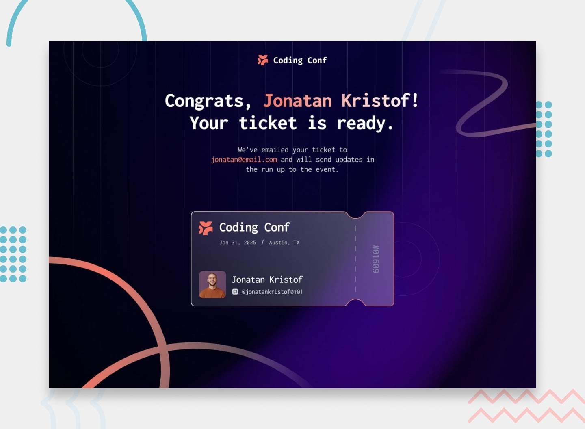

# Coding Conf - Gerador de Ingressos

Aplicação web desenvolvida para geração de ingressos personalizados para a conferência **Coding Conf 2025**. O projeto permite que o usuário insira seus dados, faça upload de avatar via clique ou arrastar e soltar (drag & drop), realize a validação dos dados em tempo real e gere um ingresso digital estilizado.



---

## Funcionalidades

- **Design Responsivo:** Interface adaptada para diferentes resoluções (Mobile, Tablet e Desktop).
- **Upload de Avatar com Prévia:**
  - Suporte a seleção por clique e arrastar e soltar (*drag & drop*).
  - Validação de tipos permitidos (`image/png`, `image/jpeg`).
  - Limite de tamanho de arquivo (máximo de 500KB) com aviso visual em caso de erro.
  - Opções para remover e alterar o avatar carregado.
- **Validação de Formulário:**
  - Verificação de campos obrigatórios (nome, e-mail e usuário do GitHub).
  - Validação de formato de e-mail com regex.
  - Formatação automática do handle do GitHub (adiciona `@` caso não informado).
- **Geração Dinâmica do Ingresso:**
  - Exibição dos dados preenchidos, avatar do participante e geração aleatória de número de ticket único de 5 dígitos.
  - Botão de reinício ("Generate Another Ticket") para redefinir o formulário e gerar um novo ticket.
- **Acessibilidade e Usabilidade:**
  - Navegação via teclado.
  - Atributos ARIA (`aria-live`, `aria-describedby`, `aria-invalid`, `role="status"`).
  - Estados claros de foco e hover em todos os elementos clicáveis.

---

## 🛠️ Tecnologias Utilizadas

- **HTML5:** Estruturação semântica utilizando tags como `<header>`, `<main>`, `<section>`, `<form>`, `<label>`, etc.
- **CSS3:** Estilização com Vanilla CSS, utilizando:
  - Variáveis CSS (Custom Properties) para cores e espaçamentos.
  - Efeitos de *glassmorphism* e gradientes.
  - Flexbox e Media Queries para responsividade fluida.
  - Tipografia importada (Google Fonts - *Inconsolata*).
- **JavaScript (ES6+):** Lógica de manipulação de DOM, leitura de arquivos locais via `FileReader API`, drag & drop events e validação de formulários.

---

## 📁 Estrutura de Arquivos

```
conference-ticket-generator/
│
├── assets/
│   ├── css/
│   │   └── style.css            # Estilos gerais e responsividade
│   ├── fonts/                   # Arquivos locais de fontes
│   ├── images/                  # SVGs, ícones e planos de fundo
│   └── js/
│       └── main.js              # Lógica de validação, upload e geração do ingresso
│
├── design/                      # Mockups de referência do design (desktop/mobile)
├── index.html                   # Estrutura principal da aplicação
├── preview.jpg                  # Imagem de prévia da aplicação
└── README.md                    # Documentação do repositório
```

---

## 💻 Como Executar o Projeto

1. Clone o repositório em sua máquina:
   ```bash
   git clone https://github.com/SEU-USUARIO/conference-ticket-generator.git
   ```

2. Acesse a pasta do projeto:
   ```bash
   cd conference-ticket-generator
   ```

3. Abra o arquivo `index.html` em seu navegador preferido ou utilize uma extensão como o **Live Server** no VS Code.
